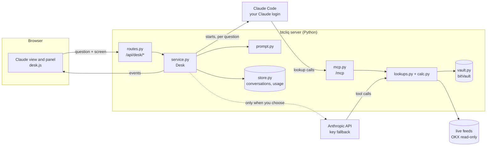

---
categories:
  - "[[Architecture]]"
summary: The whole chat on one page - the parts, how they connect, and where each lives in the code.
status: built
created: 2026-11-13
---
"Claude Desk" is the name of the chat inside btcliq since the 2026-11-13 update: the **Claude view** (fourth tab), the small **Claude panel**, and the server code in `src/btcliq/desk/`.

Before this update the chat received one text snapshot per question and could do nothing else. Now it also has **lookups** it can run while answering, **knowledge notes** from this vault, **memory**, and a **usage meter**.

## The parts

| Part | Does | Note |
|---|---|---|
| Claude view and panel | Sends the question with what is on screen; draws the answer, a card per lookup, the usage chip | [[Question flow]] |
| Desk | Picks the engine, builds the prompt, relays events, saves the conversation | [[Engines]] |
| Prompt | Standing instructions, the snapshot, the conversation so far | [[Snapshot and prompt]] |
| Lookups | 31 read-only questions Claude can ask the app, plus 4 that prepare an action for you to confirm | [[Lookups]], [[Prepared actions]] |
| Lookup endpoint | Offers the lookups to Claude Code over MCP | [[Lookup endpoint (MCP)]] |
| Vault | Knowledge notes and pinned notes | [[Knowledge notes in the vault]] |
| Store | Every conversation word for word; the usage ledger | [[Chat memory]], [[Usage meter]] |

## Design in four sentences
1. **One list of lookups, two ways to offer it.** Claude Code gets them over MCP; the API gets them as tool definitions. Same functions, same checks.
2. **Fixed text first, fresh data last.** Instructions and the lookup list never change between questions, so Claude's cache reuses them; the snapshot is new each time and goes after.
3. **Claude never sends anything.** No lookup can place, change or cancel an order. The four prepare lookups only show you a card; sending happens in the page, after your click ([[Prepared actions]]).
4. **Nothing is lost, little is sent.** Conversations are saved in full on disk; only pinned notes, a summary and recent turns travel with a question.

## File map

| File | Role |
|---|---|
| `src/btcliq/desk/registry.py` | What a lookup is; argument checking; result packing |
| `src/btcliq/desk/lookups.py` | The lookups |
| `src/btcliq/desk/calc.py` | Calculators: volatility, GARCH runner, payoff, position risk |
| `src/btcliq/desk/prepare.py` | The four prepare lookups |
| `src/btcliq/desk/vault.py` | Reads this vault; pinned notes |
| `src/btcliq/desk/store.py` | Conversations on disk, search, usage ledger, prices |
| `src/btcliq/desk/prompt.py` | System prompt, snapshot, conversation composition, the one-click briefs |
| `src/btcliq/desk/engine_cli.py` | Claude Code engine |
| `src/btcliq/desk/engine_api.py` | API engine |
| `src/btcliq/desk/mcp.py` | The `/mcp` endpoint |
| `src/btcliq/desk/bridge.py` | Lets other Claude Code sessions reach `/mcp` |
| `src/btcliq/desk/service.py` | The Desk: one question in, events out |
| `src/btcliq/desk/routes.py` | HTTP routes and their guard |
| `src/btcliq/chat.py` | Builds the market snapshot text |
| `src/btcliq/static/desk.js`, `desk.css` | The view and the panel |
| `tests/test_desk_core.py`, `test_desk_chat.py` | [[Testing]] |

## Patches
- **Patch 1** (2026-11-13): everything that reads and answers.
- **Patch 2** (2026-11-13): [[Prepared actions]] and the always-visible risk line.

## Related
[[Safety model]] · [[Other sessions]] · [[Build process]] · [[Glossary]]
