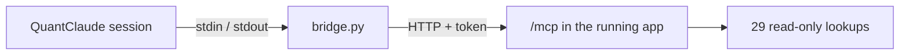

---
categories:
  - "[[Architecture]]"
summary: How QuantClaude and your other Claude Code sessions connect to the app and to this vault, in both directions.
status: built
created: 2026-11-13
---
You chose both directions.

## Sessions to the vault (knowledge in)
Three small files in `claude-project` tell every Claude Code session started there how to save research the chat will use:

| File | Does |
|---|---|
| `CLAUDE.md` | Two short pointers: where the vault is, and that live btcliq data is available |
| `.claude/skills/bitvault-note/SKILL.md` | Loaded only when a session is asked to save research: the note format, the template, the rules |
| `.mcp.json` | Registers the bridge below |

A skill is used for the details because CLAUDE.md is read by every session on every start, while a skill costs tokens only when it is needed.

## The app to sessions (live data out)
`python -m btcliq.desk.bridge` is a small helper Claude Code starts itself. It passes each lookup to the running app at `/mcp` with the long-lived read-only token, and returns the answer.

- Sessions get market data, options, your account (read-only), the calendar, knowledge, past chat conversations and the calculators.
- They do **not** get `screen` or `propose_note`, and no way to trade. The trading session keeps using `btcliq-trade` and its rails.
- When btcliq is not running, the bridge still lists the lookups and answers each call with "btcliq isn't running".
- The first time, Claude Code asks you to approve the `btcliq` server from `.mcp.json`.

## Files
`src/btcliq/desk/bridge.py`; `data/desk/endpoint.json` (address and token, written at startup); `data/desk/session-token`.

## Related
[[Lookup endpoint (MCP)]] · [[How to add a knowledge note]]
