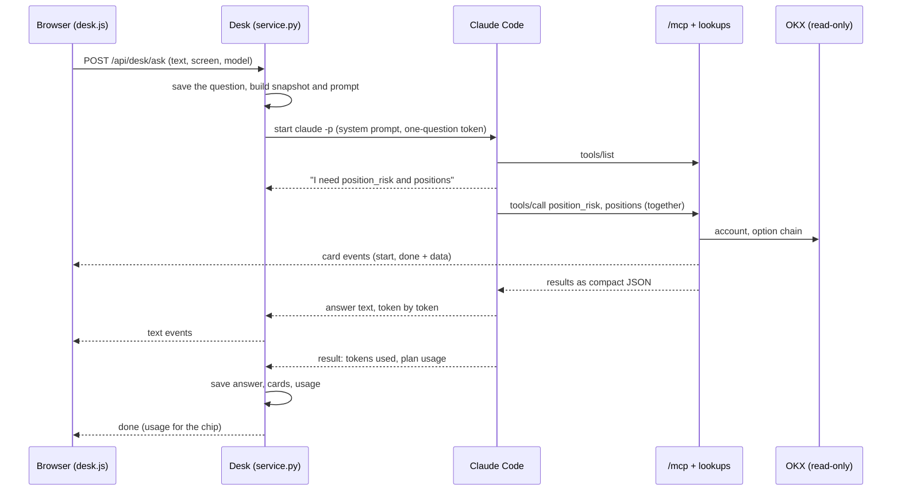

---
categories:
  - "[[Architecture]]"
summary: One question followed step by step, from pressing Enter to the saved conversation, with measured timings.
status: built
created: 2026-11-13
---
Example: you type "How are my positions doing, and what is my risk if BTC drops 5%?" in the Claude view.

## Steps
1. **The page sends** the text, the model, the web switch and a description of the screen: view, timeframe, selected contract, order ticket contents, drawings, time zone.
2. **The Desk saves the question** to the conversation file before anything else, so it survives a crash.
3. **It builds the prompt** ([[Snapshot and prompt]]): the fixed system prompt, then the conversation so far, the fresh snapshot, the screen, the question.
4. **It creates a token** that exists only while this question is answered, and starts Claude Code with the address of `/mcp` and that token ([[Engines]]).
5. **Claude decides** whether the snapshot is enough. Here it is not, so it asks for two lookups in one step.
6. **Claude Code calls `/mcp`**. The endpoint checks the token, runs each lookup ([[Lookups]]), and returns compact JSON. The same moment, it sends the page the events that draw each lookup's card.
7. **Claude writes the answer**, which streams to the page as it is produced.
8. **Claude Code reports** the tokens used and your plan's usage; the Desk records them ([[Usage meter]]).
9. **The Desk saves** the answer exactly as shown (text, cards, usage) and tells the page it is done. The token stops working.

## Measured on this PC (Sonnet 5.5, 2026-11-13)

| Question | Lookups | Time | Tokens in | of which cached | Tokens out |
|---|---|---|---|---|---|
| Positions and risk (first in a conversation) | 2 | 12.0 s | 34.6k | 16.5k | 907 |
| "Nearest big cluster above price?" (follow-up) | 0 | 4.1 s | 19.7k | 9.7k | 122 |

Each round with Claude re-sends the context, so an answer with lookups counts its input twice or more; the repeat is read from cache. The fixed part (instructions plus lookup list, about 7k tokens) is cached for an hour across questions.

## If something goes wrong
- **Plan limit reached:** the page offers "Continue on API key" if a key is set and the daily cap has room ([[Engines]]).
- **You press Stop:** the page drops the connection; the Desk stops Claude Code and saves what was written, marked "stopped".
- **A lookup fails:** its card turns red with the reason; Claude is told and can try another way.
